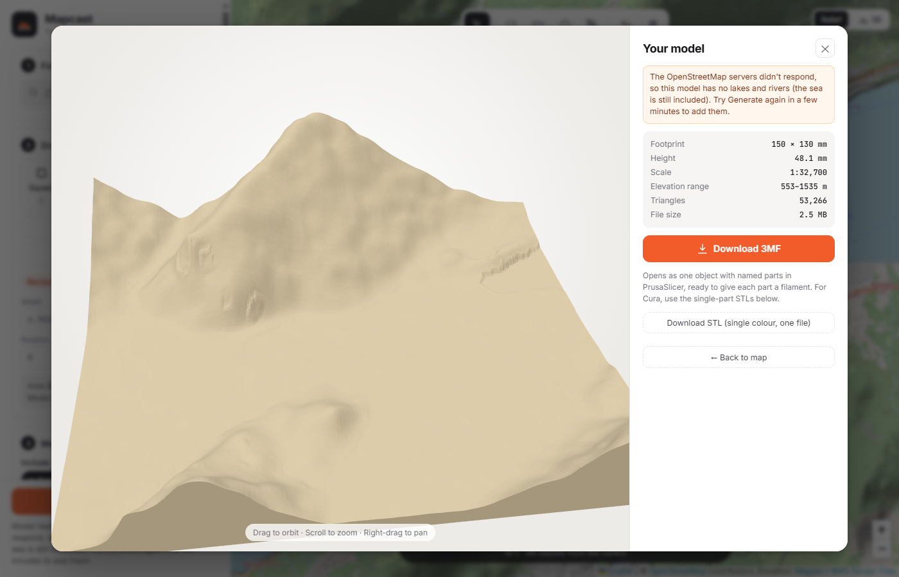

# Topoforge

Turn any place on Earth into a 3D-printable model. Find a location, draw the area you want, and download its terrain, with lakes, rivers, roads and buildings if you like, as a ready-to-slice 3MF or STL file.

Everything runs in your browser. There's no account, no API key and no build step.



## Features

- **Real terrain** from open elevation data, shown on an OpenStreetMap map with relief shading and a 3D view.
- **Multi-colour parts:** water, buildings, roads, a GPX route and a text label each come out as their own part, so you can print them in different filaments.
- **3MF download** that opens in PrusaSlicer as one object with named, coloured parts, plus plain STL files for every slicer.
- **Stepped terrain**, like stacked contour layers, or a smooth surface.
- **GPX routes:** import a hike or ride and it's raised on the terrain.
- **Tiles with connector keys** for models bigger than your print bed.
- **Every part is watertight** (checked by the test suite), so slicers don't need to repair anything.

## Quick start

You need [Node.js](https://nodejs.org) (version 20 or newer; the LTS download is fine) and an internet connection.

1. **Get the code:** click **Code → Download ZIP** on GitHub and unzip it, or clone it:
   ```sh
   git clone https://github.com/jahitjanberk/Topoforge.git
   ```
2. **Start it:**
   - **Windows:** double-click `start.bat`.
   - **macOS / Linux:** run `./start.sh` in a terminal from the folder (or `npm start`).
3. Your browser opens **http://localhost:8080**. Keep the window that started it open while you use the app; close it to stop.

Port 8080 already in use? Pick another: `PORT=8081 ./start.sh` on macOS/Linux, or `set PORT=8081 && node serve.js` on Windows.

There's also a hosted copy at **https://jahitjanberk.github.io/Topoforge/**.

## Using it

1. **Find a place:** search for a town, address or coordinates.
2. **Draw your print area** with the square, rectangle, circle or pen tool, or click *Or use the current map view*.
3. **Choose what to include** (terrain, water, buildings, roads), the model size, and any extras: stepped surface, label, tiles.
4. Click **Generate 3D model**. Progress and then the finished model appear in a pop-up.
5. **Download 3MF** for multi-colour printing, or **STL** for a single colour, and open it in your slicer.

Tips:
- Press **3** (or click **3D**) for a 3D terrain view of the map.
- The settings panel warns you before generating when the area is too big for some layers. At country scale, streets and houses are far too small to print, so they're left out automatically.
- Very large models can be slow in slicers. The 3MF download is several times smaller than the STL.

## Troubleshooting

- **The street map says "Access blocked", or the page says it can't load the map:** you opened `index.html` directly. Start the app with `start.bat` / `start.sh` instead. OpenStreetMap only serves map tiles to pages with a web address, which a file opened from disk doesn't have.
- **"The OpenStreetMap servers didn't respond":** the free servers that supply roads, buildings and water are busy or down. The model is still built from terrain alone; try again in a few minutes for the rest.
- **The slicer freezes on import:** the file is probably very large. Use the 3MF download, untick Buildings or Roads, use a smaller area, or split into tiles.

## Fair use of the free map services

Every copy of Topoforge uses free, community-run services: OpenStreetMap's map tiles and the Overpass API (roads, buildings, water). They're fine for personal use, but they have [usage policies](https://operations.osmfoundation.org/policies/tiles/), and Overpass limits heavy users. Please don't script mass downloads. If you run Topoforge for many people, switch to your own or a commercial tile server: the tile address is `OSM.url` in `js/basemaps.js`.

## Credits and licences

Topoforge is released under the [MIT License](LICENSE).

**Data** (credited in the app as well):
- Map data © [OpenStreetMap contributors](https://www.openstreetmap.org/copyright), available under the Open Database License (ODbL).
- Elevation: [Terrain Tiles](https://registry.opendata.aws/terrain-tiles/) on AWS Open Data (originally from Mapzen), built from public sources including SRTM, GMTED, ETOPO1 and national elevation models. See their [attribution list](https://github.com/tilezen/joerd/blob/master/docs/attribution.md).

**Libraries**, loaded from public CDNs and not bundled in this repository:

| Library | Version | Licence |
|---|---|---|
| [Leaflet](https://leafletjs.com) | 1.9.4 | BSD-2-Clause |
| [three.js](https://threejs.org) | 0.187.0 | MIT |
| [MapLibre GL JS](https://maplibre.org) | 4.7.1 | BSD-3-Clause |
| [Delaunator](https://github.com/mapbox/delaunator) | 5.1.0 | ISC |
| [earcut](https://github.com/mapbox/earcut) | 3.2.4 | ISC |
| [Inter](https://rsms.me/inter/), [JetBrains Mono](https://www.jetbrains.com/lp/mono/) fonts | — | SIL Open Font License |

## Development

```sh
npm install          # once: dev copies of the geometry libraries the page loads from the CDN
npm test             # unit tests (Node, no network): every mesh part must be a watertight solid
npm run test:e2e     # browser tests in headless Edge/Chrome (needs internet; BROWSER=… to pick one)
```

The unit tests run automatically on GitHub for every push and pull request. `test/solid.mjs` holds the watertightness check: every edge is used exactly twice, in opposite directions, with positive volume. The unit tests and the browser tests share it. Screenshots from the browser tests are saved to `test/output/`.

The scripts in `js/` are plain (non-module) scripts, so the page needs no build step. Each file wraps its code in a function and shares what other files need on `window.Topoforge`, so load order in `index.html` matters.

```
index.html        page markup
css/style.css     all styles
img/              logo, favicon, README screenshot
serve.js          tiny local web server (start.bat / start.sh / npm start)
js/
  app.js          entry point: map, drawing tools, search, settings, persistence
  basemaps.js     OpenStreetMap layer + relief shading computed from elevation tiles
  terrain3d.js    3D terrain view (MapLibre GL, lazy-loaded)
  generator.js    runs model generation in a Web Worker (progress, cancel)
  worker.js       the Web Worker: loads geo/data/mesh/model and builds the model
  model.js        print area + settings → mesh layers (no DOM; runs in the worker)
  water.js        rasterised water mask: lake levels, rivers, shoreline points
  gpx.js          GPX parser (tracks + routes) and route simplification
  label.js        text → traced outlines for the raised label
  steps.js        stepped terrain: height rounding + contour point pairs
  threemf.js      3MF export (zip + model XML, coloured parts)
  mesh.js         terrain / water / building / road mesh builders
  data.js         elevation tiles + OpenStreetMap (Overpass) download
  geo.js          projection and 2D geometry helpers
  preview.js      the model pop-up: progress, three.js preview, downloads
  stl.js          binary STL writer + download
  dom.js          $ / $$ shortcuts
```

# How it works

## Mesh size

The terrain mesh is adaptive. Cells start large and are split, worst first, where a flat surface would miss the real height by more than ~7% of the mesh spacing (about 0.05 mm at Standard). Splitting stops once the vertex count reaches what an even grid would use, so a model is never bigger than before. Flat ground (plains, lakes, terrace tops) gets a few large triangles, and the saved vertices go to the most detailed ground. Measured with `npm run test:e2e measure`:

| Area | Even grid | Adaptive |
|---|---|---|
| Netherlands polders (flat) | 93,728 triangles | 12,210 (13%) |
| Lake Thun, water on | 139,484 | 115,990 (83%) |
| Lake Thun, stepped | 207,890 | 148,052 (71%, with sparser contour pairs) |
| Bernese Alps (steep) | 93,728 | 92,500 (99%) |

Roads and buildings are simplified to what the model can show (0.05 mm). Road pieces are split only where the ground under them bends. Central Zurich at 3 km went from 38.2 MB to 20.4 MB this way (roads 391k → 173k triangles, buildings 360k → 206k). Models over 50 MB as STL get a warning with ways to shrink them, because some slicers freeze on very large files.

On a synthetic test landscape the adaptive mesh uses 44% fewer triangles with the same height error as the even grid (max 0.33 mm, average 0.034 mm; see `test/mesh.test.mjs`).

## Detail by scale

The map scale decides how much OpenStreetMap detail a model can show. A printed road is at least ~0.8 mm wide: at 1:500,000 that's a 400 m wide band.

| Scale | Roads | Buildings | Water |
|---|---|---|---|
| up to 1:50,000 | all | yes | all |
| to 1:75,000 | main + residential | yes | all |
| to 1:150,000 | main + residential | no | all |
| to 1:300,000 | motorway → secondary | no | lakes with an outline ≥ ~10 mm on the model |
| to 1:500,000 | motorway → secondary | no | same, without riverbank outlines (river lines stay) |
| beyond | motorways + trunk roads | no | same |

Left-out layers aren't downloaded, which keeps country-sized requests within what the free servers will answer. The area panel and the model notes say what was left out.

## GPX routes

**Import a GPX route…** in step 2, or drop a `.gpx` file on the map. Track segments and routes are read; waypoints are ignored. The route is drawn on the 2D map and in the 3D view, and the print area is fitted around it unless it's already inside one. In the model it becomes a raised strip that follows the terrain, as its own `*-route.stl` part. Width and height are under Advanced.

## Downloads

- **Download 3MF** (main button): one file with every part named and coloured, as one object (or one object per tile). Verified in PrusaSlicer 2.9.7: it opens as one object with each part as a named volume, kept in place and ready to give each a filament. Bambu Studio and OrcaSlicer descend from PrusaSlicer but haven't been tested. Cura reads only the standard 3MF layout, where each piece is a single mesh; use the single-part STLs there.
- **Download STL**: the whole model as one single-colour STL.
- **Parts / tiles list**: single-part STLs, and with tiles, one 3MF per tile.

The 3MF writer (`js/threemf.js`) needs no library: it builds the XML with shared vertices and writes the zip itself, compressing with the browser's `CompressionStream`. Each piece is one mesh with its parts stored back to back. `Metadata/Slic3r_PE_model.config` names each part's triangle range, the way PrusaSlicer stores multi-part objects. With plain 3MF components instead, PrusaSlicer splits the parts into separate objects and drops each onto the bed, so buildings and roads lose their place on the terrain.

## Tiles

**Split into tiles** (columns × rows, up to 6 × 6) cuts a model that is bigger than your print bed into pieces that fit together. The panel shows each tile's size as you change it. Each tile is built as its own set of watertight parts, from the print outline clipped to the tile. Tiles share one height scale and base, so they line up exactly. Buildings and road/route pieces that cross a seam are cut at it. The preview spreads the tiles slightly apart; downloaded files keep their real positions. Each tile downloads as one file, or part by part for multi-colour. With a label, the label plate is its own piece.

**Connector keys** (on by default when tiled) join neighbouring tiles. Each seam gets a bowtie key about every 50 mm. Both tiles have a half-dovetail pocket cut into their underside at the seam, wider inside than at the edge, so a key locks the tiles together and holds them in line. Print the *Connector keys* piece (keys are 0.15 mm smaller than the pockets and 0.2 mm thinner than they are deep), push one into each pair of pockets from below, and add a drop of glue. Pockets are only cut where at least 0.8 mm of model remains above them; a position under a lake moves along the seam, or is skipped with a note.

Freeform areas whose outline crosses a tile edge more than once can get an uneven edge on that tile (the app notes it). Concave buildings that a seam would break apart are left out of that tile.

## Label

Type a **Label on the base** (or click *Use place name*) to add a plate along the front edge of the model, with the text raised on it as its own `*-label.stl` part. The plate is part of the base. Text height scales with the model width, and long text is shrunk to fit. The text is drawn in a bold system font, traced into outlines (letter holes kept), and extruded, so any font or script the browser can draw works.

## Stepped terrain

Set **Terrain surface** to *Stepped* for flat terraces like stacked contour layers, with **Step height** in model millimetres. Heights are rounded down to whole steps, and mesh points are placed in pairs straddling each contour line, so every step edge is a near-vertical wall. The surface is still a single heightfield, so water, buildings, roads, routes and labels all work as usual. Expect about twice the triangles of the smooth surface.

## Water

With **Water** on, lakes, reservoirs, rivers and canals from OpenStreetMap become a separate part (`*-water.stl`) for multi-colour printing. Sea is included as well when "Flatten sea floor" is on.

- Lakes are flattened to one level (the median elevation over the lake). Rivers follow the terrain.
- The terrain under water is recessed by the **Water depth** setting, and the water part fills that recess exactly. The two parts meet with no gap or overlap, and each is watertight.
- Water features smaller than about 2 × 2 mm on the model are skipped. River lines are widened to stay printable.
- Sea is detected by elevation (at or below 0 m), so land below sea level, such as Dutch polders, also shows up as water.
